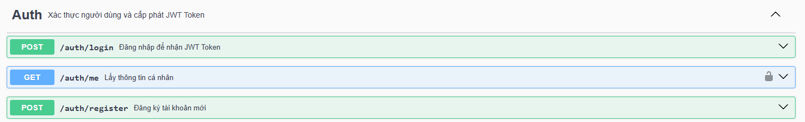
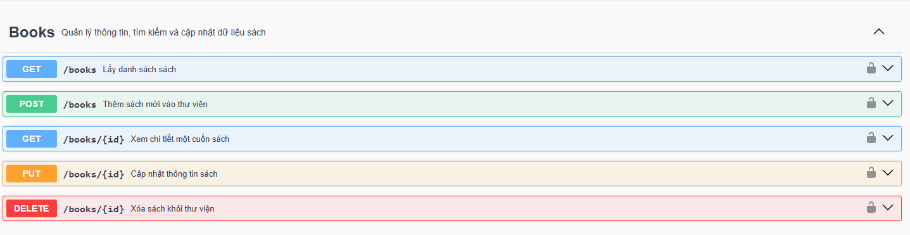
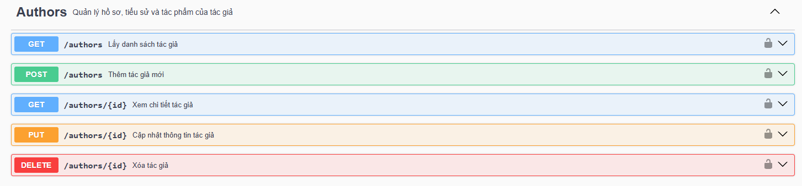
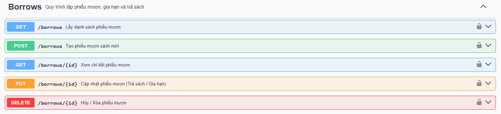
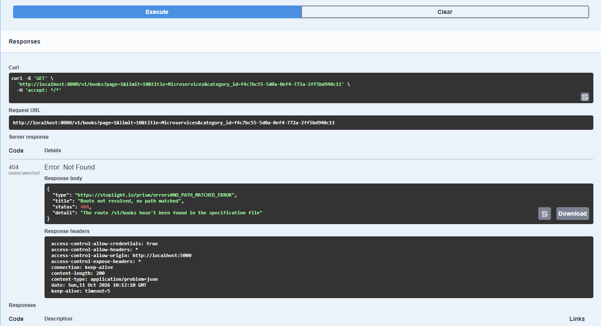
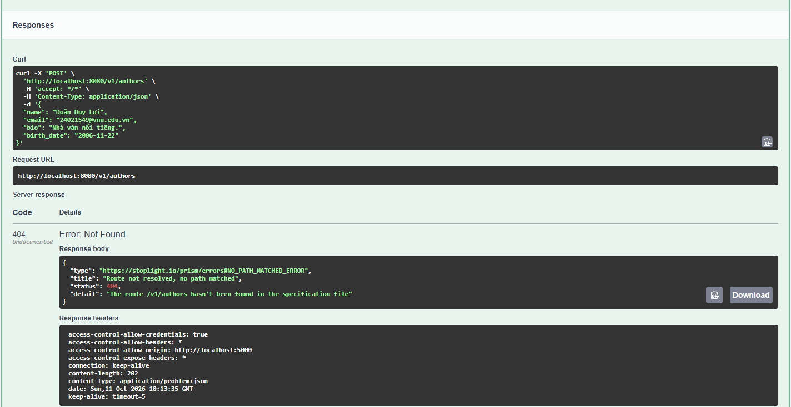

# Book Management RESTful API


## Thông tin nhóm

**Nhóm 8 — Lớp học phần: INT3505E 1 (Kiến trúc hướng dịch vụ)**

| STT | Họ và tên | Mã sinh viên | Vai trò |
| :-: | :-- | :-- | :-- |
| 1 | Doãn Duy Lợi | 24021549 | Team Leader, Root Spec, Auth APIs |
| 2 | Nguyễn Phúc Thành | 24021629 | Module Quản lý Sách |
| 3 | Nguyễn Xuân Tường | 24021669 | Module Quản lý Tác giả |
| 4 | Hoàng Lâm Tùng | 24021661 | Module Mượn/Trả sách |
| 5 | An Đức Minh Trí | 24021645 | Common Schemas, README |

---

## Tính năng chính

| Module | Mô tả |
| :-- | :-- |
| **Auth** | Đăng nhập, đăng ký, xem thông tin cá nhân (JWT Bearer Token) |
| **Books** | CRUD sách, phân trang, tìm kiếm theo `title`, lọc theo `category_id` |
| **Authors** | CRUD tác giả, phân trang, tìm kiếm theo tên |
| **Borrows** | Tạo phiếu mượn, gia hạn/trả sách, hủy phiếu, lọc theo `user_id` và `status` |

### Minh hoạ
**Auth**



**Books**



**Authors**



**Borrows**



**Điểm kỹ thuật nổi bật**

- Kiến trúc **modular**: chia file theo `paths/` và `components/`, liên kết bằng `$ref`.
- Chuẩn hóa phản hồi lỗi bằng `ErrorResponse` / `ErrorDetail`.
- Phân trang thống nhất bằng `PaginationMeta`.
- Bảo mật toàn cục bằng `BearerAuth` (JWT).

---

## Cấu trúc thư mục

```text
Group8_APITasks/
├── README.md                          # Tài liệu giới thiệu & hướng dẫn chạy dự án
├── package.json                       # Script lint / bundle / preview / mock (Redocly, Prism)
├── requirements.txt                   # Thư viện Python (Flask, PyYAML)
└── task-api/
    ├── openAPI.yaml                   # [FILE GỐC] Root OpenAPI Specification 3.0.3
    ├── bundled-openapi.yaml           # Bản spec đã gộp thành 1 file (sinh bởi npm run bundle)
    ├── app.py                         # Server Flask cung cấp Swagger UI
    ├── plan.md                        # Kế hoạch phân công và quy chuẩn kỹ thuật
    ├── paths/                         # Endpoints chia theo module
    │   ├── auth.yaml                  # Đăng nhập, đăng ký, thông tin cá nhân
    │   ├── books.yaml                 # Quản lý sách
    │   ├── authors.yaml               # Quản lý tác giả
    │   └── borrows.yaml               # Mượn / trả sách
    └── components/                    # Tài nguyên tái sử dụng
        ├── schemas.yaml               # Model & DTO (Book, Author, BorrowRecord, User, Error...)
        └── responses.yaml             # Phản hồi lỗi chuẩn (400, 401, 403, 404, 409, 422, 500)
```

---

## Công nghệ sử dụng

- **OpenAPI 3.0.3** (YAML)
- **Python Flask** + **PyYAML**: phục vụ Swagger UI
- **Redocly CLI**: lint, bundle, preview tài liệu
- **Prism CLI**: dựng mock server từ spec

---

## Hướng dẫn cài đặt và chạy

### Yêu cầu

- Python 3.9+
- Node.js 18+ (nếu dùng Redocly / Prism)


### Cách 1: Xem Swagger UI bằng Flask

```bash
# Tại thư mục gốc của dự án
pip install -r requirements.txt
python task-api/app.py
```

Sau đó mở trình duyệt:

| Đường dẫn | Nội dung |
| :-- | :-- |
| http://localhost:5000/docs | Giao diện Swagger UI |
| http://localhost:5000/openapi.json | Spec dạng JSON |

### Cách 2: Dùng Redocly / Prism

```bash
npm install

npm run lint      # Kiểm tra cú pháp và quy chuẩn của spec
npm run bundle    # Gộp spec thành task-api/bundled-openapi.yaml
npm run preview   # Xem tài liệu bằng Redoc
npm run mock      # Chạy mock server (nên chạy bundle trước)
```

### Cách 3: Swagger Editor online

Mở [editor.swagger.io](https://editor.swagger.io), chọn **File → Import file** rồi chọn `task-api/bundled-openapi.yaml`.

---

## Danh sách endpoint

Base URL (local): `http://localhost:8080/v1`

| Method | Endpoint | Mô tả | Cần token |
| :-: | :-- | :-- | :-: |
| POST | `/auth/login` | Đăng nhập, nhận JWT | Không |
| POST | `/auth/register` | Đăng ký tài khoản | Không |
| GET | `/auth/me` | Thông tin người dùng hiện tại | Có |
| GET | `/books` | Danh sách sách (phân trang, tìm kiếm, lọc) | Có |
| POST | `/books` | Thêm sách mới | Có |
| GET | `/books/{id}` | Chi tiết một cuốn sách | Có |
| PUT | `/books/{id}` | Cập nhật sách | Có |
| DELETE | `/books/{id}` | Xóa sách | Có |
| GET | `/authors` | Danh sách tác giả | Có |
| POST | `/authors` | Thêm tác giả | Có |
| GET | `/authors/{id}` | Chi tiết tác giả | Có |
| PUT | `/authors/{id}` | Cập nhật tác giả | Có |
| DELETE | `/authors/{id}` | Xóa tác giả | Có |
| GET | `/borrows` | Danh sách phiếu mượn (lọc theo `user_id`, `status`) | Có |
| POST | `/borrows` | Tạo phiếu mượn | Có |
| GET | `/borrows/{id}` | Chi tiết phiếu mượn | Có |
| PUT | `/borrows/{id}` | Cập nhật phiếu (trả sách / gia hạn) | Có |
| DELETE | `/borrows/{id}` | Hủy / xóa phiếu mượn | Có |

---

## Quy ước chung của API

### Xác thực

Các endpoint yêu cầu token cần gửi header:

```http
Authorization: Bearer <access_token>
```

Lấy token qua `POST /auth/login`:

```json
{
  "access_token": "eyJhbGciOiJIUzI1NiIsInR5cCI6IkpXVCJ9...",
  "token_type": "Bearer",
  "expires_in": 3600
}
```

### Phân trang

Các endpoint danh sách nhận `page` (mặc định 1) và `limit` (mặc định 10, tối đa 100), trả về:

```json
{
  "data": [],
  "pagination": {
    "page": 1,
    "limit": 10,
    "total_items": 150,
    "total_pages": 15
  }
}
```

### Định dạng lỗi

```json
{
  "code": 400,
  "message": "Dữ liệu yêu cầu không hợp lệ",
  "timestamp": "2026-10-08T19:40:00Z",
  "details": [
    { "field": "title", "issue": "Trường title không được để trống" }
  ]
}
```

### Mã HTTP sử dụng

| Mã | Ý nghĩa |
| :-: | :-- |
| 200 | Thành công (GET, PUT) |
| 201 | Tạo mới thành công (POST) |
| 204 | Xóa thành công, không trả dữ liệu (DELETE) |
| 400 | Dữ liệu gửi lên không hợp lệ |
| 401 | Chưa xác thực hoặc token hết hạn |
| 403 | Không có quyền thực hiện thao tác |
| 404 | Không tìm thấy tài nguyên |
| 409 | Xung đột dữ liệu (trùng lặp, trạng thái không cho phép) |
| 422 | Dữ liệu đúng cú pháp nhưng sai nghiệp vụ |
| 500 | Lỗi máy chủ nội bộ |

---

## Ảnh minh họa

> Runnable "Try it out"




---

# Quyết định thiết kế và các đánh đổi trong dự án

## 1. Chia nhỏ spec thành nhiều file và quản lý tham chiếu `$ref` chéo

**Bối cảnh và thách thức**

Năm thành viên cùng làm việc song song trên một bộ đặc tả API. Nếu dồn tất cả vào một file `openapi.yaml`, nhóm sẽ thường xuyên gặp xung đột khi merge trên Git. Vì vậy nhóm tách spec thành cấu trúc nhiều tầng: file gốc `openAPI.yaml`, các file endpoint trong `paths/*.yaml`, và các thành phần dùng chung trong `components/schemas.yaml` và `responses.yaml`.

Cách tách này giải quyết được vấn đề cộng tác, nhưng đặt ra bài toán về khả năng tương thích của các công cụ phân giải tham chiếu (resolver):

* Theo chuẩn OpenAPI 3.0.3, đường dẫn tương đối giữa các file con (ví dụ từ `paths/books.yaml` trỏ sang `../components/schemas.yaml`) rất dễ bị sai khi nạp qua các công cụ khác nhau như Swagger UI, Redocly, Prism Mock Server hay Swagger Editor.
* Ở file gốc `openAPI.yaml`, nhóm còn chọn cách đưa toàn bộ `schemas` vào bằng một tham chiếu duy nhất: `$ref: "./components/schemas.yaml"`, buộc parser phải dereference đầy đủ theo JSON Pointer, nếu không các schema con sẽ không được phân giải.

**Giá trị mang lại**

Ranh giới trách nhiệm rõ ràng: mỗi thành viên phụ trách một module, có thể phát triển và kiểm thử độc lập mà không ảnh hưởng đến người khác.

## 2. Tách DTO cho request và response, chuẩn hóa lỗi và phân trang dùng chung

**Bối cảnh và thách thức**

Với các thực thể chính (`Book`, `Author`, `BorrowRecord`), nhóm phải chọn giữa việc dùng chung một schema hay tách thành các DTO chuyên biệt. Mỗi thao tác có yêu cầu khác nhau:

* Khi tạo mới (`POST`), client không được gửi `id`, `created_at`, `updated_at`.
* Khi cập nhật (`PUT`/`PATCH`), một số trường là tùy chọn hoặc chỉ được sửa một phần (ví dụ trạng thái của phiếu mượn).
* Khi trả về, phản hồi cần đủ các trường kiểm toán (audit) và các quan hệ liên kết, chẳng hạn thông tin tác giả hoặc sách đi kèm phiếu mượn.

Nhóm chọn tách rõ ràng: `Book` cho dữ liệu đầu ra, `BookCreateInput` và `BookUpdateInput` cho dữ liệu đầu vào, `BookListResponse` để bọc danh sách cùng `PaginationMeta`.

Song song đó, nhóm đặt ra một hợp đồng chung về bảo mật và xử lý lỗi:

* `BearerAuth` được áp dụng mặc định ở cấp gốc, riêng các endpoint xác thực tắt đi bằng `security: []`.
* Mọi API đều phải trả lỗi theo cùng một định dạng `ErrorResponse` gồm `code`, `message`, `timestamp` và `details`.

**Giá trị mang lại**

Hệ thống nhất quán dù do năm người khác nhau viết.

---

## Giấy phép

Dự án phát hành theo giấy phép [MIT](https://opensource.org/licenses/MIT).

**Liên hệ:** Doãn Duy Lợi — [24021549@vnu.edu.vn](mailto:24021549@vnu.edu.vn)
